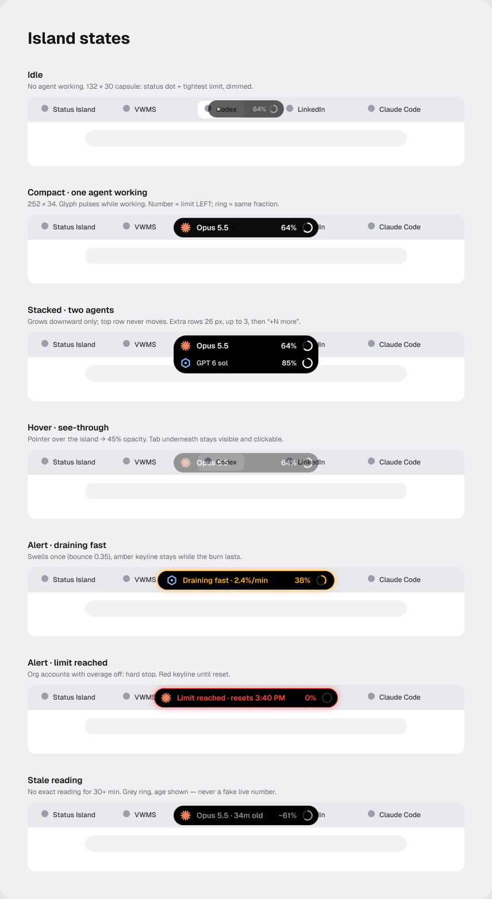

# Status Island

A Dynamic-Island-style overlay for Windows that shows, live, which AI coding agent is working, how much of its plan limit is left, how fast that limit is draining, and how full its context window is. When a limit drains fast while you're away from your desk, it sends a push to your phone.

Supports Claude Code, Codex and OpenCode on Windows 10 and 11 (x64 and ARM64).

## What it promises

- **Read-only.** It reads only files the agents write themselves. It never reads your login, never sends requests with your account, and never intercepts traffic.
- **No fake numbers.** Every figure is exact, or clearly labelled as an estimate with its age.
- **No admin rights.** Per-user install, and every change it makes can be undone.

## Safety rules

1. **Never read credentials.** No `.credentials.json`, OAuth tokens, `*.key` files, IDE lock files, browser cookies or keychains.
2. **Never make requests with the user's account.** No calls to Anthropic, OpenAI or claude.ai endpoints. No hidden agent sessions. Never spend the user's tokens to read their usage.
3. **No interception of network traffic** (no proxies or relays).
4. **Only official, documented mechanisms:** the Claude Code status line, the Claude VS Code extension's `claudeProcessWrapper` setting, and local files the agents write themselves.
5. **Local only.** The only outbound traffic is phone push (ntfy) and an optional update check. Push messages carry the agent name, %, project name and times. Never prompts or code.
6. **Every change can be undone, and uninstall undoes it automatically.**

## Download

Get the installer from the [v0.1.1 preview release](https://github.com/Hossain-13/status-island/releases/tag/v0.1.1-preview): `Status.Island_0.1.1_x64-setup.exe`, or `Status.Island_0.1.1_arm64-setup.exe` for ARM laptops.

The builds aren't code-signed yet, so Windows SmartScreen may say "Windows protected your PC". Click **More info → Run anyway**. Every release is built by the public [GitHub Actions workflow](.github/workflows/release.yml) from this source.

If your antivirus flags it, please report a false positive to Microsoft: https://www.microsoft.com/en-us/wdsi/filesubmission

## How it reads your agents

| Agent | What it reads | What it changes |
|---|---|---|
| Codex | Its session files in `~/.codex/sessions` | Nothing |
| OpenCode | Its session table in its local database (read-only) | Nothing |
| Claude Code | Its session and transcript files in `~/.claude` | Only if you switch on the Claude connector (see below) |

**The Claude connector** is optional, one switch on the Connect screen. It makes Claude's limits live in two ways:

- **Terminal:** it sets Claude Code's documented `statusLine` to Status Island's small status line program. Your previous status line command is saved and still runs, so its output still shows.
- **VS Code panel:** it sets the Claude extension's documented `claudeCode.claudeProcessWrapper` to `si-wrap.exe`. VS Code then starts Claude through it. The wrapper passes everything through unchanged, and copies **only** the limit messages Claude already sends to the panel. It never stores conversation content, never touches your login, and makes no network requests.

Both settings files are backed up before the change.

## Undo

- Settings → Claude connector → **Turn off and restore my settings** puts both files back exactly as they were.
- Uninstalling does the same automatically, then removes the app's data from `%LOCALAPPDATA%\StatusIsland`.

## Docs

- Design: [`docs/superpowers/specs/2026-10-18-status-island-design.md`](docs/superpowers/specs/2026-10-18-status-island-design.md)
- Build plan: [`docs/superpowers/plans/2026-10-18-status-island-v1.md`](docs/superpowers/plans/2026-10-18-status-island-v1.md)
- Visual design: [`docs/design/`](docs/design/)

MIT licensed.
